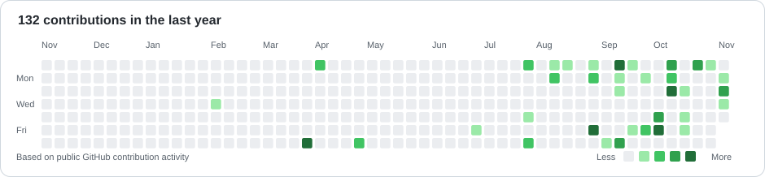
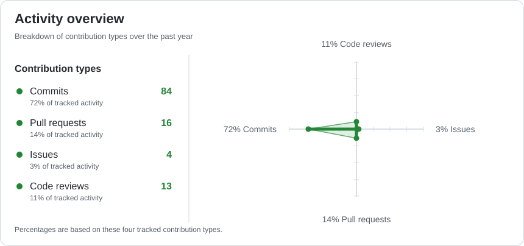

<!-- GitHub Profile · BaiZhouziYou -->

  

  <h2>This is BaiZhouziYou, an ordinary student. 👋</h2>
  
<b>Student Developer · Minecraft · Web Development · Automation</b>

  
Interested in Minecraft server and mod development, web applications, bots, open-source tools, and Linux servers.

  
  
  

---

### 👨‍💻 About Me

- 🔭 I'm currently working on **Minecraft mods, community websites, and automation tools**.
- 🧩 I enjoy exploring **Fabric, Java, Node.js, and Linux**.
- 🌱 Always learning new technologies and contributing to open-source projects that interest me.
- 💬 Feel free to ask me about Minecraft modding, server technologies, and open-source projects.

  ⚡ 3 × 12 = 36　·　2 × 12 = 21　·　1 × 12 = 12　·　0 × 12 = 18

---

### 🧰 My Skill Set

**Languages & Frontend**

  <picture>
    <source media="(prefers-color-scheme: dark)" srcset="https://skillicons.dev/icons?i=java,js,py,php,html,css&amp;perline=4&amp;theme=dark" />
    
  </picture>

**Backend & Databases**

  <picture>
    <source media="(prefers-color-scheme: dark)" srcset="https://skillicons.dev/icons?i=nodejs,mysql,sqlite,redis&amp;theme=dark" />
    
  </picture>

**DevOps & Tools**

  <picture>
    <source media="(prefers-color-scheme: dark)" srcset="https://skillicons.dev/icons?i=linux,nginx,docker,git,githubactions,bash&amp;perline=4&amp;theme=dark" />
    
  </picture>

**Minecraft Development**

  <picture>
    <source media="(prefers-color-scheme: dark)" srcset="https://skillicons.dev/icons?i=java,gradle,idea&amp;theme=dark" />
    
  </picture>

---

### 🚀 Featured Projects

<!-- Compact two-column cards. Keep descriptions short for mobile layouts. -->
<table>
  <tr>
    <td width="50%" valign="top">
      
<strong>🧨 <a href="https://github.com/BaizhouziYou/CreeperBoom">CreeperBoom</a></strong>

      
Fabric mod for player-head drops and creeper explosion settings.

      
Java · Fabric

      <a href="https://modrinth.com/mod/creeperboom">Modrinth</a>
    </td>
    <td width="50%" valign="top">
      
<strong>🌐 <a href="https://github.com/BaizhouziYou/xintinglei-website">Xintinglei Website</a></strong>

      
Community website with server status and history tracking.

      
JavaScript · Node.js · SQLite

    </td>
  </tr>
  <tr>
    <td width="50%" valign="top">
      
<strong>📚 <a href="https://github.com/BaizhouziYou/XintingleiOfficialDocs">Xintinglei Official Docs</a></strong>

      
Versioned Minecraft community documentation built with VitePress.

      
VitePress · Node.js

      <a href="https://docs.xintinglei.cn">Read Docs</a>
    </td>
    <td width="50%" valign="top">
      
<strong>🎨 <a href="https://github.com/BaizhouziYou/easybot-image-templates">EasyBot Image Templates</a></strong>

      
Customizable player, server-status, and performance graphics.

      
HTML · CSS · JavaScript

    </td>
  </tr>
  <tr>
    <td colspan="2" valign="top">
      
<strong>🥮 <a href="https://github.com/BaizhouziYou/XintingleiExtras">Xintinglei Extras</a></strong>

      
Minecraft Fabric mod adding 18 drinks and four varieties of interactive, placeable mooncakes.

      
Java · Fabric · Minecraft

    </td>
  </tr>
</table>

---

### 📊 GitHub Stats

<!-- All stats are generated daily by this repository's GitHub Actions. -->
<!-- Use <picture> to match the visitor's light / dark GitHub theme. -->
<table>
  <tr>
    <td width="50%" align="center" valign="top">
      <picture>
        <source media="(prefers-color-scheme: dark)" srcset="https://raw.githubusercontent.com/BaizhouziYou/BaiZhouziYou/main/profile-assets/stats-dark.svg" />
        
      </picture>
    </td>
    <td width="50%" align="center" valign="top">
      <picture>
        <source media="(prefers-color-scheme: dark)" srcset="https://raw.githubusercontent.com/BaizhouziYou/BaiZhouziYou/main/profile-assets/langs-dark.svg" />
        
      </picture>
    </td>
  </tr>
</table>

  <picture>
    <source media="(prefers-color-scheme: dark)" srcset="https://raw.githubusercontent.com/BaizhouziYou/BaiZhouziYou/main/profile-assets/contributions-dark.svg" />
    
  </picture>

<!-- Contribution-type overview: generated by scripts/generate_contributions.py. -->

  <picture>
    <source media="(prefers-color-scheme: dark)" srcset="https://raw.githubusercontent.com/BaizhouziYou/BaiZhouziYou/main/profile-assets/activity-dark.svg" />
    
  </picture>

---

  Thanks for visiting! Feel free to connect and collaborate on GitHub.

