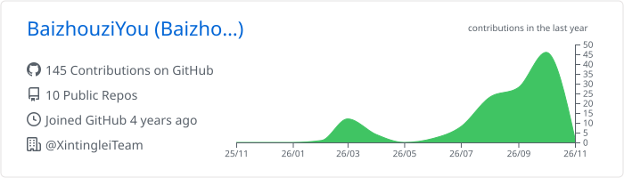
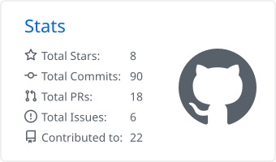
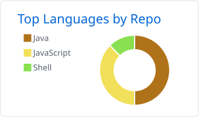
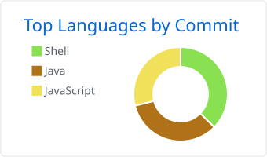
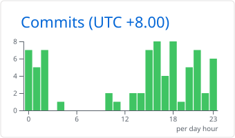

<!-- GitHub Profile · BaiZhouziYou -->

  

  <h2>This is BaiZhouziYou, an ordinary student. 👋</h2>
  
<b>Student Developer · Minecraft · Web Development · Automation</b>

  
Interested in Minecraft server and mod development, web applications, bots, open-source tools, and Linux servers.

  
  
  

---

### 👨‍💻 About Me

- 🔭 I’m currently working on **Minecraft mods, community websites, and automation tools**.
- 🧩 I enjoy exploring **Fabric, Java, Node.js, and Linux**.
- 🌱 Always learning new technologies and contributing to open-source projects that interest me.
- 💬 Feel free to ask me about Minecraft modding, server technologies, and open-source projects.

  ⚡ 3 × 12 = 36　·　2 × 12 = 21　·　1 × 12 = 12　·　0 × 12 = 18

---

### 🧰 My Skill Set

**Languages & Frontend**

  <picture>
    <source media="(prefers-color-scheme: dark)" srcset="https://skillicons.dev/icons?i=java,js,py,php,html,css&amp;theme=dark" />
    
  </picture>

**Backend & Databases**

  <picture>
    <source media="(prefers-color-scheme: dark)" srcset="https://skillicons.dev/icons?i=nodejs,mysql,sqlite,redis&amp;theme=dark" />
    
  </picture>

**DevOps & Tools**

  <picture>
    <source media="(prefers-color-scheme: dark)" srcset="https://skillicons.dev/icons?i=linux,nginx,docker,git,githubactions,bash&amp;theme=dark" />
    
  </picture>

**Minecraft Development**

  <picture>
    <source media="(prefers-color-scheme: dark)" srcset="https://skillicons.dev/icons?i=java,gradle,idea&amp;theme=dark" />
    
  </picture>

---

### 🚀 Featured Projects

<table>
  <tr>
    <td width="50%" valign="top">
      <h3><a href="https://github.com/BaizhouziYou/CreeperBoom">🧨 CreeperBoom</a></h3>
      
A lightweight Minecraft Fabric mod that lets charged creepers drop player heads and provides configurable explosion behavior.

      
<code>Java</code> <code>Fabric</code> <code>Gradle</code>

      <a href="https://github.com/BaizhouziYou/CreeperBoom">Source Code</a> · <a href="https://modrinth.com/mod/creeperboom">Modrinth</a>
    </td>
    <td width="50%" valign="top">
      <h3><a href="https://github.com/BaizhouziYou/xintinglei-website">🌐 Xintinglei Website</a></h3>
      
A Minecraft community website with a self-hosted server status service, status API, WebSocket checks, and history tracking.

      
<code>JavaScript</code> <code>Node.js</code> <code>SQLite</code>

      <a href="https://github.com/BaizhouziYou/xintinglei-website">Source Code</a>
    </td>
  </tr>
  <tr>
    <td width="50%" valign="top">
      <h3><a href="https://github.com/BaizhouziYou/easybot-mod">🤖 EasyBot Mods</a></h3>
      
A Minecraft mod integration for EasyBot, using Stonecutter to support multiple mod loaders and game versions.

      
<code>Java</code> <code>Minecraft</code> <code>Stonecutter</code>

      <a href="https://github.com/BaizhouziYou/easybot-mod">Source Code</a>
    </td>
    <td width="50%" valign="top">
      <h3><a href="https://github.com/BaizhouziYou/EasybotPlugins">🛠️ EasybotPlugins</a></h3>
      
A collection of bot plugins built for the Easybot platform, with plugins maintained across multiple versions.

      
<code>Bots</code> <code>Plugin Development</code> <code>Automation</code>

      <a href="https://github.com/BaizhouziYou/EasybotPlugins">Source Code</a>
    </td>
  </tr>
</table>

---

### 📊 GitHub Stats

<!-- The light and dark SVG cards are generated daily by GitHub Actions. -->

  <picture>
    <source media="(prefers-color-scheme: dark)" srcset="https://raw.githubusercontent.com/BaizhouziYou/BaiZhouziYou/main/profile-summary-card-output/github_dark/0-profile-details.svg" />
    
  </picture>

<table>
  <tr>
    <td width="50%" align="center" valign="top">
      <picture>
        <source media="(prefers-color-scheme: dark)" srcset="https://raw.githubusercontent.com/BaizhouziYou/BaiZhouziYou/main/profile-summary-card-output/github_dark/3-stats.svg" />
        
      </picture>
    </td>
    <td width="50%" align="center" valign="top">
      <picture>
        <source media="(prefers-color-scheme: dark)" srcset="https://raw.githubusercontent.com/BaizhouziYou/BaiZhouziYou/main/profile-summary-card-output/github_dark/1-repos-per-language.svg" />
        
      </picture>
    </td>
  </tr>
</table>

<table>
  <tr>
    <td width="50%" align="center">
      <picture>
        <source media="(prefers-color-scheme: dark)" srcset="https://raw.githubusercontent.com/BaizhouziYou/BaiZhouziYou/main/profile-summary-card-output/github_dark/2-most-commit-language.svg" />
        
      </picture>
    </td>
    <td width="50%" align="center">
      <picture>
        <source media="(prefers-color-scheme: dark)" srcset="https://raw.githubusercontent.com/BaizhouziYou/BaiZhouziYou/main/profile-summary-card-output/github_dark/4-productive-time.svg" />
        
      </picture>
    </td>
  </tr>
</table>

---

  Thanks for visiting! Feel free to connect and collaborate on GitHub.

